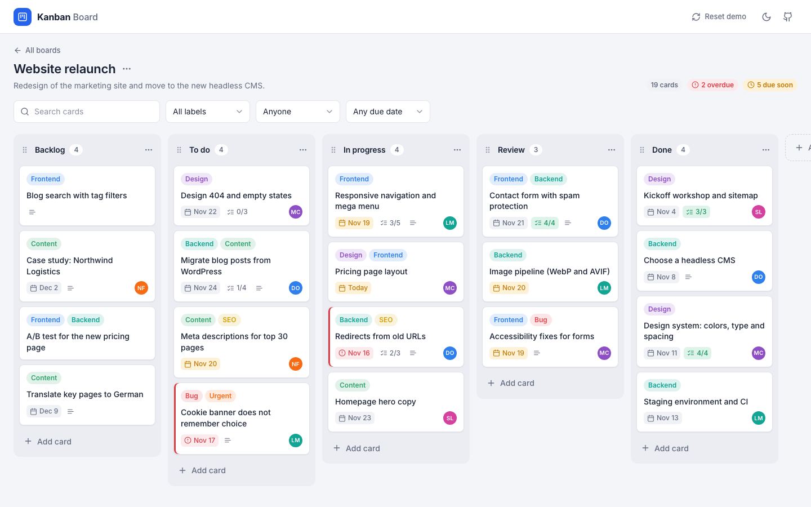
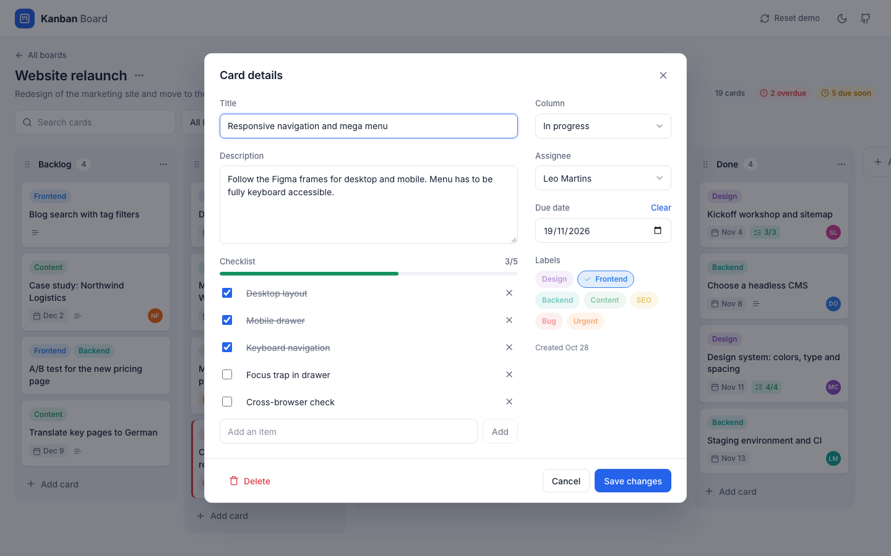
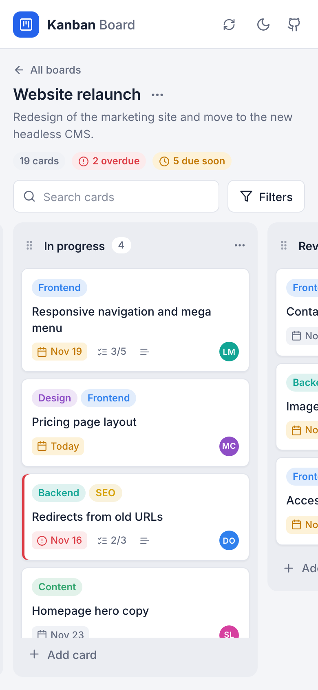

# Kanban Task Board

A fast, Trello-style kanban board built with Angular 21: plan work on boards, drag cards between columns and keep track of labels, due dates, assignees and checklists.

**[Live Demo](https://hkhodkar.github.io/kanban-task-board/)**



| Card details | Mobile |
| --- | --- |
|  |  |

## Features

- **Boards** - create, rename and delete boards, start from a template (Basic, Scrum or empty) and see progress, overdue cards and team members on the overview
- **Columns** - add, rename (double-click the title) and delete columns, reorder them by dragging the handle, card counts in every header
- **Drag and drop** - move cards between columns and reorder them with the Angular CDK; works with mouse and touch (long press on phones)
- **Card details** - edit title, description, labels, assignee, due date and column in one dialog, plus a checklist with progress
- **Due date cues** - overdue cards get a red marker, cards due today or in the next two days are highlighted, done columns are never flagged
- **Search and filters** - search titles and descriptions, filter by label, assignee (or unassigned) and due date (overdue, due this week, no date); drag and drop keeps working while filtered
- **Shareable card links** - the open card is part of the URL (`?card=...`), so links and the back button work
- **Undo** - deleted cards can be restored from the toast
- **Works offline** - everything is stored in `localStorage`, no backend or account needed
- **Demo data** - a realistic "Website relaunch" board with 19 cards (plus two smaller boards) on first visit, with a one-click reset
- **Dark mode and responsive layout** - follows your system theme, columns scroll and snap horizontally on phones

## Tech Stack

- [Angular 21](https://angular.dev) - standalone components, signals, `computed` / `linkedSignal`, new control flow (`@if`, `@for`), zoneless change detection, OnPush everywhere
- [Angular CDK](https://material.angular.dev/cdk/categories) - drag and drop, menus, focus trap
- Typed reactive forms
- Lazy-loaded routes with component input binding for route and query params
- SCSS with CSS custom properties for light and dark themes (no UI library)
- [Vitest](https://vitest.dev/) for unit tests
- GitHub Actions + GitHub Pages for deployment

## Getting Started

Requirements: Node.js 20.19+ or 22.12+ and npm.

```bash
git clone https://github.com/hkhodkar/kanban-task-board.git
cd kanban-task-board
npm install
npm start
```

Then open http://localhost:4200.

Other useful commands:

```bash
npm test -- --watch=false   # run unit tests
npm run build               # production build in dist/
```

## Project Structure

```
src/
├── app/
│   ├── core/
│   │   ├── data/          # demo boards and board templates
│   │   ├── models/        # Board, Column, Card, Label, Member and filter types
│   │   ├── services/      # BoardStore (signals + localStorage), theme, storage
│   │   └── utils/         # filtering, due date status, drop index mapping, dates (unit tested)
│   ├── features/
│   │   ├── boards/        # boards overview and create/edit board dialog
│   │   └── board/         # board view, columns, cards, filters and card detail dialog
│   ├── shared/
│   │   ├── directives/    # autofocus
│   │   └── ui/            # modal, confirm dialog, toasts, avatar, icons
│   ├── app.routes.ts      # lazy-loaded routes
│   └── app.ts             # app shell with header
└── styles/                # theme variables, base styles, buttons, forms and menus
```

## Author

**Hatef Khodkar** - [github.com/hkhodkar](https://github.com/hkhodkar)

## License

[MIT](LICENSE)
